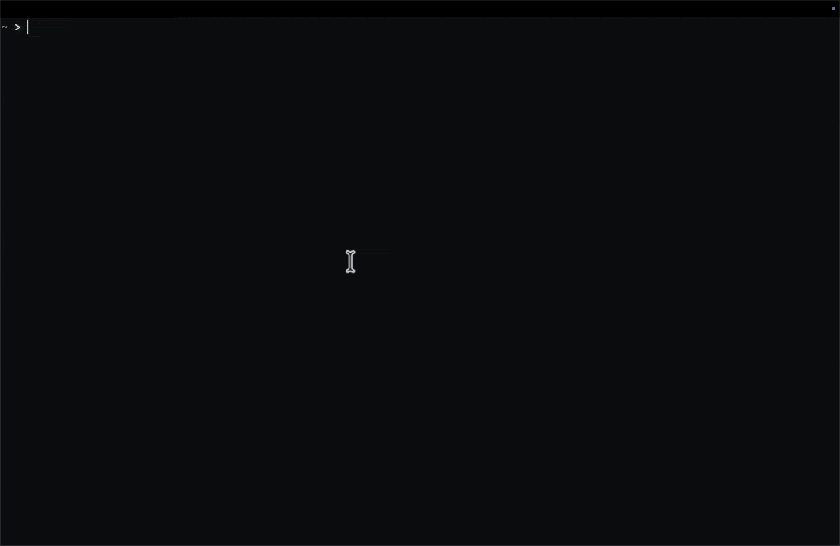

# Tuse



Tuse is a terminal coding agent you can shape with Lua. Run it as-is, adapt it to a project with `tuse.lua`, or share an entire setup without maintaining a fork. The core is written in Rust; the model uses one Lua tool to work with files, run shell commands, and compose operations.

- **Two interfaces:** a full-screen TUI and [JSON-RPC](https://ethanhamilthon.github.io/tuse/json.html) for your own front end, with shared sessions and history.
- **Bring your own provider:** OpenAI Chat Completions and Responses, Anthropic Messages, Gemini, or a compatible gateway.
- **Layered Lua configuration:** combine project config, personal defaults, and optional plugins. Add prompts, tools, commands, hooks, or themes, then reload without restarting.

## Quickstart

Install on macOS or Linux:

```sh
curl -fsSL https://raw.githubusercontent.com/ethanhamilthon/tuse/main/release/install.sh | sh
```

The installer offers official plugins one at a time when run interactively. Each is optional. Without a terminal it installs only the binary.

If you installed `login`, run `tuse` and use `/login` for subscriptions or `/connect-api` for an API key. You can also connect directly from the shell:

```sh
tuse connect --name openai --base https://api.openai.com/v1 --api openai-responses --key '$OPENAI_API_KEY'
tuse connect --name anthropic --base https://api.anthropic.com/v1 --api anthropic-messages --key '$ANTHROPIC_API_KEY'
```

Pick a model with `/models`, then send your first message. Use `tuse init` to create a project config. To update the binary, run `tuse update` and restart Tuse.

## Official plugins

| Plugin | What it adds |
| --- | --- |
| [`login`](https://github.com/ethanhamilthon/tuse/tree/main/plugins/login) | `/login`, `/logout`, `/usage`, and `/connect-api`. Connect Codex, Claude, Antigravity, Kimi, or Grok via CLIProxyAPI, or OpenCode Go directly. `/usage` shows remaining 5-hour and 7-day quotas when the provider reports them. |
| [`themes`](https://github.com/ethanhamilthon/tuse/tree/main/plugins/themes) | `/theme` with 31 palettes, including Lavender Mist. Use `/theme lavender-mist` to apply it directly, or `/theme reset` to return to your configured colors. |
| [`status`](https://github.com/ethanhamilthon/tuse/tree/main/plugins/status) | Session titles and activity in Herdr, Herdr.app, Rex, and cmux, with an OSC 7501 fallback. |
| [`rename`](https://github.com/ethanhamilthon/tuse/tree/main/plugins/rename) | An optional model-generated title from the first message, plus `/rename` for manual titles. |

Install any plugin later by name, then reload the running session:

```sh
tuse plugins add ethanhamilthon/tuse/plugins/themes
tuse plugins list
tuse plugins update
```

Plugins are Lua code that you trust. They load automatically after installation; use the [plugin selector](https://ethanhamilthon.github.io/tuse/config.html#plugins) to exclude them or pass options per project. Installing `login` does not install CLIProxyAPI or sign you in; it offers setup when you choose a subscription that needs it. OpenCode Go uses `OPENCODE_GO_API_KEY`.

## Make it yours

Project config returns a table of named namespaces. You can start with a prompt:

```lua
return {
  project = {
    prompts = {
      showme = "Explain what changed in the last commit and why, with file paths.",
    },
  },
}
```

Type `#showme` in the TUI. Your global `~/.config/tuse/init.lua` returns a function that supplies defaults; `TUSE_GLOBAL_CONFIG` can point to a different setup. Local settings take priority over global and plugin UI settings.

See [`examples/`](https://github.com/ethanhamilthon/tuse/tree/main/examples) for [skills](https://github.com/ethanhamilthon/tuse/blob/main/examples/skills.lua), [MCP](https://github.com/ethanhamilthon/tuse/blob/main/examples/mcp.lua), [themes](https://github.com/ethanhamilthon/tuse/blob/main/examples/themes.lua), [titles](https://github.com/ethanhamilthon/tuse/blob/main/examples/rename.lua), [notifications](https://github.com/ethanhamilthon/tuse/blob/main/examples/notify.lua), and integrations for [cmux](https://github.com/ethanhamilthon/tuse/blob/main/examples/cmux.lua), [Herdr](https://github.com/ethanhamilthon/tuse/blob/main/examples/herdr.lua), [Rex](https://github.com/ethanhamilthon/tuse/blob/main/examples/rex.lua), [Orca](https://github.com/ethanhamilthon/tuse/blob/main/examples/orca.lua), and [tmux](https://github.com/ethanhamilthon/tuse/blob/main/examples/tmux.lua).

## Benchmark

An earlier 50-case benchmark, included for reference. These are not measurements of the current release.

| Agent | Full passes | Time* | Input* | Output* |
| :-- | --: | --: | --: | --: |
| **Tuse 0.11.5** | **49/50** | 57.3 s | 54.7k | 11.4k |
| **OpenCode** | **49/50** | 66.2 s | 126.5k | 10.9k |
| Claude Code | 47/50 | 69.0 s | 153.8k | 13.7k |
| Pi | 46/50 | 55.3 s | **52.6k** | 11.2k |
| Codex | 46/50 | **54.4 s** | 154.0k | **9.7k** |
## Docs and contributing

Read the [documentation](https://ethanhamilthon.github.io/tuse/) or ask the agent to look it up through `docs()`. See the [changelog](https://github.com/ethanhamilthon/tuse/blob/main/release/CHANGELOG.md) for release history. Issues and pull requests are welcome. Tuse is [MIT licensed](LICENSE).
