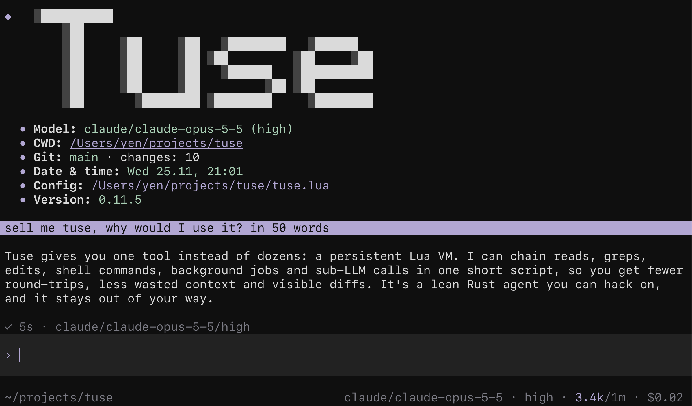

# Tuse


The simplest, most powerful AI coding agent for the terminal.

Tuse is a minimal layer that is all a modern model needs to do real work: files and a shell. Everything else you shape yourself with a small Lua config.

Tuse itself stays tiny and fast. It is written in Rust, so you can run hundreds of instances without thinking about it.

- **Code mode by default.** The agent writes Lua that does many steps at once, instead of calling tools one by one.
- **No skills, no MCP, no plugins.** Need something? Ask the agent to change its own config, and it just works.
- **TUI and JSON modes.** A fast full-screen terminal UI, and a JSON-RPC mode if you want to put your own GUI on top.
- **Under 20k lines of code.** Any agent or person can read, understand, and change Tuse.
- **Per-project configs.** Drop a `tuse.lua` into a repo and the harness is tuned for that project.
- **Any model, any provider, any multiplexer.** OpenAI, Anthropic, Gemini, or anything OpenAI-compatible.

## Quickstart

Install the binary (macOS and Linux):

```sh
curl -fsSL https://raw.githubusercontent.com/ethanhamilthon/tuse/main/release/install.sh | sh
```

Connect a provider. The key stays in your environment, and Tuse only stores the `$VAR` reference:

```sh
tuse connect --base https://api.openai.com/v1 --key '$OPENAI_API_KEY' --name openai
tuse connect --base https://api.anthropic.com/v1 --key '$ANTHROPIC_API_KEY' --name anthropic --api anthropic-messages
```

Run `tuse` in your project, pick a model with `/models`, and start talking. To customize it for a project, run `tuse init` and edit `./tuse.lua`.

## Subscriptions

Tuse does not log in to subscriptions itself, because plans and models change too fast to keep up with.

We leave that to [CLIProxyAPI](https://github.com/router-for-me/CLIProxyAPI). Install it, sign in, and connect it like any other provider:

```sh
tuse connect --base http://localhost:8317/v1 --key '$CLIPROXY_KEY' --name subs
```

EasyCLIProxyAPI is also a handy desktop client for all your subscriptions.

## [cmux](https://github.com/ethanhamilthon/tuse/blob/main/examples/cmux.lua), [Orca](https://github.com/ethanhamilthon/tuse/blob/main/examples/orca.lua), [Herdr](https://github.com/ethanhamilthon/tuse/blob/main/examples/herdr.lua), [tmux](https://github.com/ethanhamilthon/tuse/blob/main/examples/tmux.lua), [Rex](https://github.com/ethanhamilthon/tuse/blob/main/examples/rex.lua)…

Ask Tuse to write a small config for your terminal or multiplexer and `require` it from `~/.config/tuse/init.lua`. Hooks, commands, and `sh` cover [notifications](https://github.com/ethanhamilthon/tuse/blob/main/examples/notify.lua), panes, [titles](https://github.com/ethanhamilthon/tuse/blob/main/examples/rename.lua), and the rest.

## Skills, MCP, plugins

Tuse ships none of these, on purpose.

**[Skills](https://github.com/ethanhamilthon/tuse/blob/main/examples/skills.lua)** are an over-engineered name for reusable prompts. Add one to your config:

```lua
return {
  prompts = {
    showme = "Explain what changed in the last commit and why, with file paths.",
  },
}
```

Then type `#showme` in the TUI.

**[MCP](https://github.com/ethanhamilthon/tuse/blob/main/examples/mcp.lua)** is one of dozens of agent protocols, and we see no reason to build it into Tuse. If you have MCP servers you want to use, ask Tuse to wrap them in `functions`, and the agent will call them like any other Lua function.

**Plugins** made everything more complicated, so we removed them. Write the few lines you need yourself, or ask Tuse to write them, and load them from `init.lua`. See [`examples/`](https://github.com/ethanhamilthon/tuse/tree/main/examples) for ready ones.

## Benchmark

This is a small benchmark. What matters here is not quality but the efficiency of the agents. Like Pi, Tuse uses 2-3x fewer input tokens than the others, thanks to its minimalism. But unlike Pi, Tuse has much more functionality out of the box, and that does not make it slower.

| Agent | Full passes | Time* | Input* | Output* |
| :-- | --: | --: | --: | --: |
| **Tuse 0.11.5** | **49/50** | 57.3 s | 54.7k | 11.4k |
| **OpenCode** | **49/50** | 66.2 s | 126.5k | 10.9k |
| Claude Code | 47/50 | 69.0 s | 153.8k | 13.7k |
| Pi | 46/50 | 55.3 s | **52.6k** | 11.2k |
| Codex | 46/50 | **54.4 s** | 154.0k | **9.7k** |

## Docs, license, contributing

Docs are at https://ethanhamilthon.github.io/tuse/. The agent reads the same pages with `docs()`. Tuse is MIT licensed, see [LICENSE](LICENSE).

Discussions and pull requests are welcome. The project is still in beta and I work on it actively. Honestly, I don't know where it is heading, but I'm glad I built a harness that makes it hard to go back to any other.

Give Tuse a try, and if you like it too, tell me. Let's build it together!
